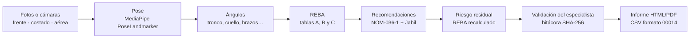

# ErgoAI · X-RAIC 2026

Asistente local para evaluar la postura de operadores en estaciones de ensamble a partir de fotografías o cámaras (Track 4, Jabil). ErgoAI detecta la pose con **MediaPipe**, mide los ángulos corporales, calcula el **REBA**, propone controles basados en la **NOM-036-1-STPS-2018** y en los lineamientos de Jabil, estima el **riesgo residual** y deja que el especialista **valide, edite o apruebe** cada recomendación antes de emitir el informe.

> Las fotografías de Jabil son confidenciales. Todo se procesa y guarda en el equipo: el servidor solo escucha en `127.0.0.1`, las tomas de cámara se guardan con el rostro difuminado y `data/`, `out/`, `capturas/` y `models/` no se versionan.

## Contenido

- [Inicio rápido](#inicio-rápido)
- [Cómo funciona](#cómo-funciona)
- [Instalación](#instalación)
- [Uso](#uso)
- [Dónde se guardan los datos](#dónde-se-guardan-los-datos)
- [Privacidad y manejo de datos](#privacidad-y-manejo-de-datos)
- [Métodos](#métodos)
- [Arquitectura](#arquitectura)
- [Configuración](#configuración)
- [Pruebas](#pruebas)
- [Construir el ejecutable](#construir-el-ejecutable)
- [Solución de problemas](#solución-de-problemas)
- [Estado y límites conocidos](#estado-y-límites-conocidos)
- [Estructura del repositorio](#estructura-del-repositorio)
- [Licencias de terceros](#licencias-de-terceros)

## Inicio rápido

| Quiero… | Usa |
|---|---|
| Usar ErgoAI sin instalar Python | El [ejecutable de escritorio](#ejecutable-de-escritorio) |
| Trabajar desde el código | `uv sync`, `uv run python scripts/descargar_modelo.py` y `uv run ergoai-gui` |
| Automatizar evaluaciones | La [línea de comandos](#línea-de-comandos) |

## Cómo funciona



1. **Entrada**: vistas de costado, frente y aérea, subidas como archivo o capturadas con las cámaras del equipo cada N segundos.
2. **Pose y ángulos**: se elige a la persona más visible, se corrige la orientación y se miden los ángulos con banderas de baja visibilidad, escorzo y cercanía a un límite REBA.
3. **REBA**: bandas por segmento, tablas A/B/C, carga, agarre y actividad, por cada lado del cuerpo. Si falta un dato, queda como pendiente; nunca se rellena con un valor «típico».
4. **Recomendaciones**: un motor de reglas propone controles ordenados por jerarquía (ingeniería → rediseño de estación → administrativas), cada uno con su fundamento y los puntos de REBA que reduce.
5. **Riesgo residual**: el REBA se recalcula aplicando el efecto esperado de los controles no rechazados y se compara con el inicial.
6. **Validación**: el agente propone y el especialista decide. Cada aprobación, edición, rechazo o corrección de ángulo queda firmada en una bitácora encadenada por hash. El informe está en BORRADOR hasta que el especialista lo aprueba.
7. **Informe**: HTML autocontenido (imprimible a PDF) con postura, REBA, recomendaciones, riesgo residual, bitácora y tiempos, más un CSV con las columnas de «OBSERVACIONES Y MEJORAS» del formato 16-PE80-6500-00014.

## Instalación

Requisitos:

- [uv](https://docs.astral.sh/uv/). Instala y fija **Python 3.12** (`.python-version`).
- Para la ventana de la aplicación y las cámaras: Edge, Chrome, Chromium o Brave. Sin ellos se usa el navegador predeterminado.
- Node.js 20 o superior, solo si vas a modificar la interfaz web.

```powershell
git clone https://github.com/Sudo-Dev-Mavs/Ergo-AI--X-RAIC.git
cd Ergo-AI--X-RAIC
uv sync
uv run python scripts/descargar_modelo.py   # pose (30 MB) y detector de rostros (230 KB)
```

`descargar_modelo.py` solo descarga los modelos públicos de MediaPipe; no envía ninguna imagen. Los comandos funcionan igual en PowerShell y en una terminal de Linux.

## Uso

### Ejecutable de escritorio

Descomprime `ErgoAI-windows-*.zip` o `ErgoAI-linux-*.tar.gz` y abre **ErgoAI** (`ErgoAI.exe` en Windows). La aplicación levanta su servidor local, abre su propia ventana y se detiene al cerrarla. Si ya está abierta, abrirla de nuevo solo muestra otra ventana.

| Opción | Para qué |
|---|---|
| `--datos <carpeta>` o `ERGOAI_DATOS` | Cambiar la carpeta de datos (por defecto `~/ErgoAI`). |
| `--puerto <n>` | Puerto local preferido (por defecto 8765; si está ocupado usa otro). |
| `--sin-ventana` | Solo levantar el servidor e imprimir la URL. |
| `ERGOAI_NAVEGADOR` | Ruta de un navegador concreto para la ventana. |

En Linux, `./instalar-acceso-directo.sh` agrega ErgoAI al lanzador de aplicaciones.

### Interfaz web

```powershell
uv run ergoai-gui                    # abre http://127.0.0.1:8765/
uv run ergoai-gui --sin-navegador    # solo el servidor
```

La interfaz ya viene compilada en `src/ergoai/web/dist`; no hace falta Node para usarla. Escribe tu nombre en **Firmas como** (riel lateral): cada decisión queda registrada con él. En el mismo riel, **Opciones** ajusta la densidad de la interfaz, la foto con que abre un caso (anotada u original), si se pide confirmación al aprobar o rechazar y si el visor muestra sus atajos; se guardan en este equipo.

**Inicio · Evaluaciones ergonómicas**
- Botón **Nueva evaluación** en el encabezado y, al costado, **Cómo funciona** (plegable).
- **Casos**, ordenados por riesgo: primero los de mayor riesgo sin validar. Cada caso muestra su REBA, el residual esperado, las propuestas por validar, el estado de validación y un acceso directo a **Validar**. Si falta un dato, el REBA aparece como rango (por ejemplo «4–6 · Medio, estimado»).

**Nueva evaluación**, en tres pasos entre los que puedes ir y volver antes de analizar:

1. **Fotografías**
   - Para cada vista (costado, frente, aérea) elige *Archivo* o *Cámara*.
   - **Detectar cámaras** lista las cámaras conectadas con su nombre. Asigna una a cada vista y verás la imagen en vivo. La asignación se recuerda para la próxima vez.
   - **Capturar cada N** (de 2 s a 60 min), con **Iniciar/Detener** y **Capturar ahora**. Cada *toma* captura todas las cámaras asignadas en el mismo instante y las capturas siguen mientras llenas los pasos 2 y 3.
   - Elige qué toma analizar; por defecto, la más reciente. Cada toma indica «Rostro difuminado» o «Sin persona en…».
2. **Tarea**: identificador, tipo de tarea (levantamiento, transporte con o sin auxiliar u otra), carga, agarre, postura y tipo de trabajo.
3. **Lo que la foto no muestra**: ajustes REBA observados en piso (estática, repetitiva, base inestable, fuerza brusca, hombro elevado, brazo apoyado, muñeca desviada), un resumen de lo que se va a analizar y **Analizar postura**.

Con costado y frente se obtiene un REBA completo; la aérea agrega la torsión del tronco. Sin la vista de frente, el apoyo de piernas y la abducción quedan pendientes.

**Validación**
- **Cola** con los casos cuyo informe no está aprobado, ordenada por nivel de riesgo y propuestas pendientes; se puede ocultar.
- Al centro, la evidencia (visor de fotos con zoom, costado, frente y aérea, anotada u original) y las recomendaciones para aprobar, editar o rechazar.
- A la derecha, el comparador **Inicial vs Residual**. Si el especialista considera que el agente fue optimista, mueve el control del residual (1–15), escribe el motivo y guarda: el residual queda como «Ajuste manual», el cambio entra en la bitácora y el informe vuelve a BORRADOR. **Restaurar IA** regresa al residual calculado por el agente.
- **Aprobar acciones de piso** se habilita cuando hay nombre en «Firmas como», no quedan propuestas sin decidir y no hay bloqueos.

**Caso**
- Goniómetro con el REBA medido (aguja sólida) y el residual esperado (aguja punteada), datos de la tarea, tiempo de análisis y el comparador Inicial vs Residual.
- **Recomendaciones**: aprobar, editar, rechazar con motivo o agregar controles propios. **Aprobar informe** se habilita cuando no quedan propuestas sin decidir. Las propuestas se dibujan con borde punteado, las aprobadas con trazo sólido y las rechazadas tachadas.
- **Postura medida**: ángulos por segmento con su banda REBA y banderas. El especialista puede corregir un ángulo; ErgoAI recalcula y lo registra.
- **Bitácora**: historial firmado con verificación de integridad.
- **Informe**: vista previa, impresión a PDF y descarga del CSV para el formato 00014.

La interfaz anterior en Tk sigue disponible como respaldo con `uv run ergoai-tk`; no incluye cámaras ni el asistente.

### Línea de comandos

Cada caso es una carpeta `data/casos/<caso_id>/` con imágenes `frente`, `costado` y/o `aerea` (`.jpg`/`.png`) y un `contexto.json`:

```json
{
  "caso_id": "caso01",
  "realizado_por": "Ing. Pérez",
  "tipo_tarea": "levantamiento",
  "tipo_trabajo": "ligero",
  "postura": "de_pie",
  "orientacion_costado": null,
  "carga_kg": 16,
  "agarre": "regular",
  "fuerza_brusca": false,
  "actividad": {"estatica_mas_1min": true, "repetitiva_mas_4_por_min": false, "cambios_bruscos_o_base_inestable": false},
  "hombro_elevado": {"izquierdo": false, "derecho": false},
  "brazo_apoyado": {"izquierdo": false, "derecho": false},
  "muneca_desviada_o_torcida": {"izquierdo": false, "derecho": false},
  "overrides": {}
}
```

- `tipo_tarea`: `levantamiento`, `transporte_con_auxiliar`, `transporte_sin_auxiliar` u `otro`.
- `tipo_trabajo`: `precision`, `ligero` o `pesado`.
- `postura`: `de_pie`, `sentado` o `alternada`.
- `agarre`: `bueno`, `regular`, `malo` o `inaceptable`.
- `orientacion_costado`: `derecha`, `izquierda` o `null` para detectarla.
- `overrides`: ángulos corregidos por el especialista, por ejemplo `{"tronco_flexion": 35, "brazo_flexion_L": 50}`.

```powershell
uv run ergoai pose data/casos/caso01       # landmarks y esqueleto
uv run ergoai angulos data/casos/caso01    # vectores, ángulos e imágenes anotadas
uv run ergoai evaluar data/casos/caso01    # REBA, recomendaciones, residual e informe borrador

# Decisiones del especialista: quedan en la bitácora y regeneran el informe
uv run ergoai validar out/caso01 aprobar --usuario "Ing. Pérez" --rec R-TRONCO-ING
uv run ergoai validar out/caso01 editar --usuario "Ing. Pérez" --rec R-TRONCO-ING --campo responsable="IE celda 3" --campo fecha_compromiso=2026-12-01
uv run ergoai validar out/caso01 rechazar --usuario "Ing. Pérez" --rec R-AGARRE-RED --comentario "contenedor del cliente"
uv run ergoai validar out/caso01 agregar --usuario "Ing. Pérez" --campo problema="..." --campo solucion="..." --campo jerarquia=rediseno
uv run ergoai validar out/caso01 ajustar_residual --usuario "Ing. Pérez" --campo riesgo_residual_proyectado=6 --comentario "el lifter no elimina toda la flexión"
uv run ergoai validar out/caso01 limpiar_residual --usuario "Ing. Pérez"   # vuelve al residual del agente
uv run ergoai validar out/caso01 aprobar_informe --usuario "Ing. Pérez"
uv run ergoai informe out/caso01           # regenera informe.html y el CSV
```

### Medir la precisión

El procedimiento completo (armado del conjunto, referencia a ciegas, interpretación) está en [`docs/PROTOCOLO_VALIDACION.md`](docs/PROTOCOLO_VALIDACION.md). Cada caso de validación va en `data/validacion/<caso>/` con sus fotos, `contexto.json` y un `referencia.json` que tiene el REBA de Jabil y/o los ángulos de referencia.

```powershell
uv run python scripts/evaluar_precision.py --plantilla data/validacion/caso01   # referencia.json para completar
uv run python scripts/evaluar_precision.py                                      # evalúa y escribe out/precision/
uv run python scripts/anotar_manual.py data/validacion/caso01/costado.jpg --vista costado   # opcional: landmarks a mano
```

`out/precision/reporte.html` muestra el **criterio 1** (casos en que el REBA y el nivel coinciden con Jabil) y el **criterio 2** (porcentaje de segmentos en la misma banda REBA; los no estimados cuentan como fallo), con el nivel de la rúbrica que corresponde, el error por segmento y por vista y la lista de fallos con sus banderas. Los casos de validación se evalúan en `out/precision/`, separados de los de la interfaz.

## Dónde se guardan los datos

Con el ejecutable, la carpeta de datos es `~/ErgoAI` (`C:\Users\<usuario>\ErgoAI` en Windows). Desde el código (`ergoai-gui`, `ergoai`) es la raíz del repositorio.

| Ruta | Contenido |
|---|---|
| `data/casos/<caso>/` | Entrada: fotos por vista, `contexto.json` y `<vista>.pose.json` si la foto vino de una toma de cámara. |
| `out/<caso>/resultado.json` | Ángulos, REBA, recomendaciones, riesgo residual y tiempos. |
| `out/<caso>/validacion.json` | Estado de cada recomendación y bitácora encadenada. |
| `out/<caso>/informe.html` | Informe del estudio (BORRADOR o APROBADO). |
| `out/<caso>/acciones_00014.csv` | Acciones con las columnas de «OBSERVACIONES Y MEJORAS». |
| `out/<caso>/*_pose.png`, `*_angulos.png` | Esqueleto y ángulos anotados por vista. |
| `out/precision/` | Reporte de precisión (`reporte.html`, `precision.csv`, `resumen.json`) y resultados de los casos de validación. |
| `capturas/<borrador>/<toma>/` | Tomas temporales de cámara, ya difuminadas: máximo 120 por evaluación, se borran a las 24 h o con **Descartar tomas**. |
| `config/umbrales.yaml` | Umbrales; se copia la primera vez y no se sobrescribe al actualizar. |
| `models/` | Modelos de MediaPipe. |
| `ergoai.log` | Registro del ejecutable. |

Para borrar un caso, elimina `data/casos/<caso>/` y `out/<caso>/`.

## Privacidad y manejo de datos

- **Local**: la API solo escucha en `127.0.0.1` y la interfaz no usa servicios externos; las fuentes tipográficas van empaquetadas.
- **Rostros en las tomas de cámara**: antes de guardar una toma, ErgoAI detecta la pose sobre la imagen original, ubica la cabeza (nariz, ojos, orejas y boca, con margen) y la difumina con mosaico y desenfoque. Si no hay pose, usa el detector de rostros BlazeFace.
  - En disco solo queda la imagen difuminada.
  - La pose medida antes de difuminar se guarda en `<vista>.pose.json`, ligada a la imagen por SHA-256, y el análisis la reutiliza para no perder precisión en el cuello.
  - Si el detector no está disponible, la toma **no se guarda**.
  - La vista previa en vivo no se almacena, pero muestra la cara sin difuminar en pantalla.
- **Fotos subidas como archivo**: no se modifican; deben venir ya sin rostros, como las de Jabil.
- **Trazabilidad**: cada cambio queda en `validacion.json` con usuario, fecha, valor anterior y nuevo, comentario y hash encadenado. Si alguien edita o borra una entrada fuera de ErgoAI, la verificación falla y la interfaz lo indica.
- **Datos de Jabil**: se usan solo para el reto y no se comparten fuera del equipo.

## Métodos

### Pose y ángulos

- Detector: `mediapipe` 1.1.1, `vision.PoseLandmarker` con el modelo *heavy*, en modo imagen y hasta 3 personas (se elige la de mayor área visible).
- **Costado**: flexión de tronco y de cuello, flexión de brazo, ángulo de codo, flexión de muñeca y de rodilla, por lado.
- **Frente**: inclinación lateral del tronco, abducción de brazos, giro o inclinación del cuello y apoyo en una pierna.
- **Aérea**: torsión del tronco, como ángulo entre la línea de hombros y la de caderas.
- **Respaldo entre vistas** (`respaldos.py`, tabla §7.3 de la especificación). Cuando la vista primaria no puede sostener una medida porque falta la vista o los landmarks no se ven:
  - codo y rodilla se miden en la vista de frente;
  - el apoyo de piernas sale de los tobillos en la vista de costado o de la postura declarada «sentado»;
  - el resto usa la pose 3D de MediaPipe (de costado o de frente), con planos definidos por el propio cuerpo: el sagital es perpendicular a la línea de caderas y el frontal contiene esa línea y la vertical. La abducción usa 3D y no la vista aérea, que no la mide bien.

  Estas medidas llevan la bandera `vista_respaldo`, y si solo se conoce la magnitud (flexión o extensión indistinta), también `baja_confianza_metodo`. La interfaz indica de dónde salió cada medida. Lo que no se puede medir de ninguna forma queda pendiente.
- Banderas: `baja_visibilidad`, `cerca_de_umbral` (a ±5° de un límite REBA), `posible_escorzo`, `vista_respaldo` y `baja_confianza_metodo`.
- **Imágenes anotadas** (`<vista>_angulos.png`, §7.5):
  - el esqueleto sin cara;
  - flechas de los vectores medidos;
  - el valor de cada ángulo junto a su articulación, en una etiqueta con el color de su banda REBA (1 verde, 2 amarillo, 3 naranja, 4 o más rojo);
  - «?» cuando la medida tiene banderas, y una leyenda.

  Las medidas que vienen de la pose 3D se rotulan sin flecha.

### REBA

Hignett y McAtamney (2000). Se evalúan bandas por segmento con los umbrales de `config/umbrales.yaml`, las tablas A, B y C, la carga o fuerza, el agarre y la actividad, por lado; se reporta el peor lado.

Si falta un ángulo o un ajuste, el puntaje queda pendiente, pero ErgoAI calcula el **rango** posible probando todos los valores que podría tomar lo que falta. Si todo el rango cae en un mismo nivel (por ejemplo 4–6, Medio), ese nivel se usa para priorizar y se muestra como «estimado»; si el rango cruza niveles, el nivel queda por confirmar. Completar el dato en **Postura medida** fija el puntaje.

| REBA | Riesgo | Acción |
|---|---|---|
| 1 | Inapreciable | No necesaria |
| 2–3 | Bajo | Puede ser necesaria |
| 4–7 | Medio | Necesaria |
| 8–10 | Alto | Necesaria pronto |
| 11–15 | Muy alto | Necesaria de inmediato |

### Recomendaciones

`src/ergoai/recomendaciones.py` aplica reglas sobre los ángulos y el contexto. Cada recomendación declara su jerarquía, sus referencias y su **efecto** esperado, que se usa para el riesgo residual.

| Jerarquía | Ejemplos de reglas |
|---|---|
| Ingeniería | `R-CARGA-ING` (más de 14 kg: asistencia mecánica), `R-TRANSP-ING` (auxiliar de transporte), `R-TRONCO-ING` (altura de trabajo ajustable), `R-MUNECA-ING` (otra herramienta o fixture), `R-REPET-ING` (automatizar el paso repetitivo), `R-ESTACION-ING` (control general en riesgo alto, ver abajo) |
| Rediseño de estación | `R-LEV-RED`, `R-TORSION-RED`, `R-CUELLO-RED`, `R-PIERNAS-RED`, `R-BRAZO-RED`, `R-ANTEBRAZO-RED`, `R-AGARRE-RED`, `R-AUX-RED`, `R-BASE-RED`, `R-SILLA-RED` (Ley silla) |
| Administrativa | `R-CARGA-ADM` (levantamiento en equipo como contención), `R-REPET-ADM` (rotación y pausas), `R-CAPAC-ADM` (capacitación y vigilancia a la salud) |

Fuentes:

- NOM-036-1-STPS-2018 (Apéndices I y II, masa máxima, medidas de control). Se citan sin numeral para no atribuir un inciso equivocado.
- Jabil 16-PE30-6500-00023 §6.4: límite de 14 kg por persona, evitar levantar desde el piso o sobre la cabeza (máx. 1.7 m en rack, 1.6 m en carro), 60 cm libres, Ley silla y conveyors de 0.5 a 1.4 m.
- Formato 16-PE80-6500-00014: alturas de trabajo (95–120 cm precisión, 85–110 cm ligero, 65–95 cm pesado), ayudas visuales e iluminación.

En casos de riesgo alto o muy alto (REBA ≥ 8), la NOM-036-1 no admite un paquete solo administrativo: el informe exige al menos un control de ingeniería o de rediseño aprobado, y la rotación, las pausas y la capacitación se marcan como complemento. Si en un caso así ninguna regla específica encontró un segmento medido que corregir, se agrega `R-ESTACION-ING` (mesa de altura ajustable, polipasto o rediseño de alcances). Este control no lleva efecto calculado: el agente no sabe qué solución se elegirá, así que no proyecta cuánto baja el REBA y el especialista fija el residual al validar.

### Riesgo residual

`src/ergoai/residual.py` aplica el efecto de cada control de ingeniería o rediseño **no rechazado**. Por ejemplo, la altura ajustable lleva el tronco a 10° y la asistencia mecánica lleva la carga a 0 kg. Un efecto solo mejora un valor medido: no inventa una medición ausente ni empeora una que ya está en su objetivo. Luego recalcula el REBA con el mismo método. Las medidas administrativas y los controles sin efecto no se cuentan. También calcula cuántos puntos reduce cada recomendación por sí sola. Si falta un dato, el residual también se reporta como rango.

Son estimaciones: conviene confirmarlas con una foto nueva después de implementar. Si el especialista considera que el agente fue optimista, puede fijar el residual a mano (1–15, con motivo obligatorio). La lista de casos lo marca como fijado por el especialista, el informe muestra también el valor que estimaba el agente y el cambio queda en la bitácora.

### Validación e informe

Para aprobar el informe:

- ninguna recomendación vigente puede seguir como propuesta;
- las acciones aprobadas que no son administrativas necesitan responsable;
- un caso de riesgo alto o muy alto necesita al menos un control de ingeniería o rediseño aprobado.

Cualquier cambio posterior regresa el informe a BORRADOR y queda en la bitácora. El informe registra el tiempo del agente (análisis y borrador) y el tiempo de validación humana, para medir el impacto en tiempos de respuesta.

### Complementos

`rula.py`, `eaws.py`, `nom036.py` y `muneca.py` implementan RULA, EAWS simplificado (hoja EAWS del formato 00014), sugerencias visuales de la NOM-036-1 y muñeca con HandLandmarker. Son módulos aislados: no modifican el REBA ni aparecen todavía en la interfaz.

## Arquitectura

| Módulo (`src/ergoai/`) | Responsabilidad |
|---|---|
| `io_imagenes.py`, `pose.py`, `pose_aislada.py` | Carga con corrección EXIF; MediaPipe en un proceso hijo para que un cierre nativo no tumbe el servidor. |
| `angulos.py`, `geometria.py`, `landmarks.py` | Vectores, ángulos y banderas por vista. |
| `respaldos.py` | Respaldo entre vistas y 3D para medidas que la vista primaria no sostiene. |
| `anotacion.py` | Imágenes anotadas con flechas, valores junto a cada articulación y color por banda REBA. |
| `reba.py`, `config.py` | Bandas y tablas REBA; configuración validada con Pydantic. |
| `recomendaciones.py`, `residual.py` | Motor de reglas y recálculo del riesgo residual. |
| `validacion.py`, `informe.py` | Decisiones del especialista, bitácora encadenada, informe HTML y CSV. |
| `capturas.py`, `privacidad.py` | Tomas temporales de cámara y difuminado de rostros. |
| `cli.py` | Pipeline completo y comandos `pose`, `angulos`, `evaluar`, `validar` e `informe`. |
| `servidor.py` | API FastAPI local y servidor de la interfaz compilada. |
| `escritorio.py` | Lanzador del ejecutable: carpeta de datos, servidor y ventana de aplicación. |
| `precision.py`, `reporte_precision.py` | Comparación con referencias y reporte de precisión (criterios 1 y 2). |
| `rula.py`, `eaws.py`, `nom036.py`, `muneca.py` | Complementos aislados. |
| `gui.py` | Interfaz Tk de respaldo. |

La interfaz (`web/`) usa React 19, TypeScript, Tailwind CSS 4 y `motion`, con componentes de Magic UI y Cult UI adaptados a la paleta del proyecto, en la que el color solo codifica el nivel de riesgo.

**API local** (`http://127.0.0.1:8765`; documentación interactiva en `/api/docs`):

| Método y ruta | Uso |
|---|---|
| `GET /api/casos` | Casos ordenados por riesgo. |
| `GET /api/casos/{caso}` | Resultado, validación, riesgo residual y condiciones pendientes para aprobar. |
| `POST /api/casos` | Crear o reanalizar un caso (multipart: `contexto`, fotos y/o `borrador` + `toma`). |
| `POST /api/casos/{caso}/validacion` | Aprobar, rechazar, reabrir, editar, agregar, ajustar o restaurar el residual (`ajustar_residual`, `limpiar_residual`) o aprobar el informe. |
| `POST /api/casos/{caso}/correcciones` | Corregir ángulos y recalcular. |
| `GET /api/casos/{caso}/archivos/{nombre}` | Informe, CSV e imágenes anotadas. |
| `POST`, `GET`, `DELETE /api/capturas/{borrador}` | Guardar, listar y descartar tomas de cámara. |
| `GET /api/capturas/{borrador}/{toma}/{vista}` | Imagen difuminada de una toma. |

## Configuración

`config/umbrales.yaml` concentra los umbrales de REBA, RULA, EAWS y detección. Los valores marcados `SUPUESTO` deben confirmarse con Jabil:

- tolerancia de «erguido»;
- si los límites de las bandas son inclusivos;
- umbrales de inclinación lateral, giro de cuello y abducción;
- lado que se reporta;
- *offset* neutro del cuello.

`jabil.angulo_apertura` sigue **pendiente**: es el estudio de ángulo de apertura que la rúbrica pide tomar como referencia. Con el ejecutable, edita la copia en `~/ErgoAI/config/umbrales.yaml`.

## Pruebas

```powershell
uv run pytest
```

Son 57 pruebas deterministas, sin fotografías confidenciales; usan detectores sintéticos. **No sustituyen** la medición de precisión con fotos reales ([protocolo](docs/PROTOCOLO_VALIDACION.md)). Cubren:

- geometría, ángulos y bandas REBA;
- el respaldo 3D, verificado con poses 3D construidas con ángulos conocidos, el respaldo de frente y las imágenes anotadas;
- el reporte de precisión (criterios 1 y 2 y medidas sin estimar);
- el pipeline completo, las recomendaciones y el riesgo residual;
- la bitácora (incluida la detección de alteraciones) y las condiciones para aprobar;
- la API (rutas, validaciones y *path traversal*);
- las capturas (tope, purga, análisis desde una toma);
- el difuminado (no se vuelve a detectar sobre la imagen difuminada y no se guarda nada si el detector falla);
- el proceso aislado ante un SIGKILL;
- el lanzador de escritorio, la precisión y los complementos.

Para la interfaz:

```powershell
cd web
npm install
npm run typecheck
```

## Construir el ejecutable

PyInstaller no compila de forma cruzada: el `.exe` se construye en Windows y el binario de Linux en Linux.

```powershell
uv sync
uv run python scripts/descargar_modelo.py
uv run python scripts/construir_ejecutable.py          # dist/ErgoAI/ y dist/ErgoAI-<sistema>-<arquitectura>.zip|tar.gz
uv run python scripts/construir_ejecutable.py --web    # además recompila la interfaz (requiere Node)
uv run python scripts/construir_ejecutable.py --un-archivo
```

El paquete (unos 500 MB descomprimido, 200 MB comprimido) incluye la interfaz, los modelos, la configuración inicial y las licencias de terceros. `--un-archivo` genera un solo ejecutable, que tarda más en abrir.

El workflow `.github/workflows/ejecutable.yml` construye Windows y Linux en GitHub Actions y publica los paquetes como artefactos. Se dispara al publicar una etiqueta `v*`. El botón manual (*Run workflow*) solo aparece cuando el workflow existe en la rama por defecto (`main`).

**Desarrollo de la interfaz**:

```powershell
uv run ergoai-gui --sin-navegador   # API en 127.0.0.1:8765
cd web
npm run dev                         # Vite con proxy a /api
npm run build                       # recompila src/ergoai/web/dist (se versiona)
```

## Solución de problemas

| Síntoma | Causa y solución |
|---|---|
| El análisis falla con «el detector de pose se cerró inesperadamente» o el proceso termina con código 137 | En Linux con PipeWire, `import mediapipe` cargaba `sounddevice`; PortAudio activaba `module-rt` de PipeWire, que fija `RLIMIT_RTTIME`, y el kernel mataba el proceso. ErgoAI ya bloquea ese import. Si persiste, ErgoAI se está abriendo desde una aplicación que lanza procesos con `RLIMIT_RTTIME=0` (por ejemplo, la terminal integrada de la app de escritorio de Claude): ábrelo desde el lanzador o una terminal normal. |
| «Este navegador no permite usar cámaras» o no aparecen cámaras | Abre ErgoAI con el ejecutable o en Edge/Chrome y permite el acceso a la cámara la primera vez. Si una cámara está «ocupada», ciérrala en la otra aplicación y pulsa **Volver a detectar**. |
| Las tomas se saltan con intervalos muy cortos | Cada toma detecta la pose para difuminar el rostro (alrededor de 1 s por vista). Con 3 cámaras usa N de 5 s o más. |
| «La interfaz no está compilada» | Ejecuta `npm install` y `npm run build` en `web/`, o `construir_ejecutable.py --web`. |
| `ergoai-tk` falla con `libtk8.6.so` en Linux | El Python del sistema no trae Tk. Usa el Python gestionado por uv: `uv sync --python 3.12 --managed-python`. La interfaz web no necesita Tk. |
| El REBA sale «pendiente» | Falta alguna vista o dato: revisa la pestaña **Postura medida** y la lista «Revisar en piso». |

## Estado y límites conocidos

| Área | Estado | Nota |
|---|---|---|
| Imagen, pose y ángulos | Implementado | Medición 2D por vista con respaldo entre vistas y 3D, banderas e imágenes anotadas por banda REBA. Las medidas 3D de flexión dan solo la magnitud. |
| REBA | Implementado | Ambos lados, contexto, correcciones del especialista y pendientes explícitos. |
| Recomendaciones y riesgo residual | Implementado | Reglas NOM-036-1 + Jabil con jerarquía; el efecto de cada control es una estimación y el especialista puede fijar el residual. |
| Validación, bitácora e informe | Implementado | Página de validación con cola, informe HTML/PDF y CSV 00014. |
| Interfaz web y ejecutable | Implementado | Ejecutable de Linux probado; el de Windows se construye con el workflow y aún no se ha probado. |
| Cámaras y difuminado de rostros | Implementado | Probado con cámaras simuladas de Chromium y un retrato real; falta probar con las cámaras de la estación. |
| Precisión (criterios 1 y 2 de la rúbrica) | Pendiente de datos | El protocolo, las plantillas de referencia y el reporte están listos. Falta correrlo con fotos y referencias de Jabil y demostrar 6/6 en REBA y al menos 90 % de segmentos en la misma banda. |
| Complementos (RULA, EAWS, NOM-036, muñeca) | Siguiente versión | Módulos aislados, sin integrar a la interfaz; falta validar HandLandmarker para la muñeca. |

- ErgoAI es una ayuda para el especialista; no lo sustituye.
- Si un landmark o dato no está disponible, el resultado queda pendiente; el REBA se acota con su rango posible.
- Las referencias a la NOM-036-1 no incluyen numeral de inciso; el especialista puede precisarlo al validar.

## Estructura del repositorio

```text
src/ergoai/        Pipeline, REBA, recomendaciones, validación, API, capturas, privacidad y lanzador
src/ergoai/web/    Interfaz compilada que sirve la API (se versiona para no requerir Node)
web/               Código fuente de la interfaz (React + Tailwind)
config/            Umbrales auditables
scripts/           Modelos, precisión y construcción del ejecutable
empaquetado/       Spec de PyInstaller, lanzador e ícono
docs/              Protocolo de validación de precisión
tests/             Pruebas deterministas
.github/workflows/ Construcción del ejecutable en GitHub Actions
ESPECIFICACION_POSE.md  Especificación original del módulo de pose y REBA
```

## Licencias de terceros

La interfaz incluye componentes adaptados de [Magic UI](https://github.com/magicuidesign/magicui) y [Cult UI](https://github.com/nolly-studio/cult-ui), ambos con licencia MIT; los textos completos están en `web/LICENCIAS-TERCEROS.md` y viajan dentro del ejecutable. Los modelos de MediaPipe se descargan de los repositorios públicos de Google.
